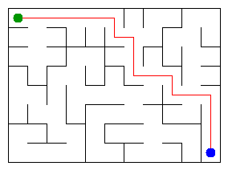

# Assignment 3. Maze Escape

Student ID: 254645
Name: Symbat Tungyshbay
Group: SE-2510
Maze size (rows x columns): 8*11

This file is the report. Fill it in as you go. How to start: `START_HERE.md`. The task: `docs/Assignment3.pdf`.

## Program output

The 13 lines your program prints on your data (`java -cp out Main`):

    Broken: 87
    Kept: 70
    Last broken wall: 132
    MST cost: 25348
    Heaviest broken wall: 896
    Path length: 17
    DFS visited: 33
    Dead ends: 29
    Zones: 11
    Largest zone: 16
    Is DAG: 0
    Flow stages: 6
    Fastest route cost: 18

My maze:

## Questions

Answer in your own words, two or three sentences each.

Mission 0. What do find and union do, and what makes them fast in your code?
find function finds parent links to the root of x's group. union function
joins groups.union is needed to to make trees more shallow, so the finds
become o1 later.

Mission 1. Why is Broken always R*C - 1, and Kept always (R-1)*(C-1)?
each union resuces number of groups by one at a time, which also means a
wall is broken. The total number of inner walls is R(C-1) + C(R-1), 
and subtracting R*C - 1 leaves (R-1)(C-1) walls kept. For my maze, 
157 - 87 = 70 = 7 × 10.

Mission 2. My MST cost from Kruskal and from Prim, and why they are equal:
both algorithms give mst cost of 25 348, cause thwy both build shallow trees.
but the algorithm is diff, kruskal does it by adding cheapest wall,
prim by growing a tree with the cheapest wall leacving it

Mission 3. Why is there exactly one path between two cells? How did you avoid a stack overflow on a huge maze?
broken walls are joined two groups, more like a connected graph. a tree is 
just a graph connected without cycles, so there is only one path btw cells.
stack oveflow is avoided by making dfs to use its own array, so depth lives 
in the heap not in a call stack

Mission 4. Why does the second pass of Kosaraju go on the reversed graph? Why do the slides have no cycle exactly when Zones equals the number of cells?
in the finish order of the first pass, the last cell to finish belongs to
a zone that no other zone can slide into. dfs on hte reversed slide from that 
cell can only reach the cells that can reach it, and those are exactly its own zone, so it can
leak into other zones. on the normal graph, the dfs could run into other zones to merge them.
if every zone has one cell ther is no cycle. if ther is one, its cells share a zone, so zones is 
smaller than the number of cells.

Mission 5. Why is it enough to go through the zones in the order of their numbers? What does this pass cost?
zones are in topological order. , when a zone is reached all other possible paths
have been processed, so the cost and the chain are already finel. 
zone has no cycles so no priority queue is needed. the pass costs o z+s, where
z is number of zones, s is the slides. each slide is looked at once.

## AI use

The syllabus requires you to say which AI tools you used and for what. Write the tool (ChatGPT, Copilot, other) and what you asked it: explain an idea, find an error, review code. Write "none" if you did not use any. If you took code or text from a book or a website, give the source here.
claude to explain me the basic concepts and walk me through the assignments requirments so i dont miss an important smth

## Timing (Mission 7)

Milliseconds, 5 runs each, from `java -cp out Bench`.

| maze | Kruskal | Prim |
|---|---------|------|
| 100 x 100 | 22      | 18   |
| 300 x 300 | 139     | 124  |
| 1000 x 1000 | 2156    | 3588 |

size   kruskal_ms (5 runs, then average)   prim_ms (5 runs, then average)
100    21 18 13 27 34  avg 22    50 12 8 13 8  avg 18
300    192 134 155 150 66  avg 139    115 158 131 105 111  avg 124
1000   1910 1950 2768 2164 1991  avg 2156    3562 3582 3532 3772 3491  avg 3588

What do the numbers say about how the time grows? Two or three sentences.
time grows faster than th enumber of walls. from 300 to 1000 the maze has for about
11 times more cells, and kruskal took 15 times longer, prim 29 times longer. 100 is a small 
number, so it grows less than 9 times. on a larger maze kruskal is faster. 
kruskal sorts the walls pnce, and does constant dsu operations, while prim builds adjacency
with many other small arrays and puts every wall into the priority queue from both sides, which
costs more time and memmory.

## Complexity

n is the number of cells, m the number of walls (or slides). Fill in every algorithm you wrote.

| algorithm | time | space | assumptions |
|---|---|---|---|
| DSU find and union |O(α(n)) per operation, almost constant; about O(m·α(n)) for m operations | O(n)|union by size and path compression together; α is the inverse Ackermann function, below 5 for any real n |
| Kruskal | O(m log m)|O(n + m) |sorting the m walls dominates; the DSU steps are almost constant. In the grid m ≈ 2n, so this is O(n log n) |
| Prim | O(m log m)| O(n + m)| binary-heap priority queue (PriorityQueue); every wall can enter the queue from both ends, so up to 2m entries; adjacency lists are built first|
| DFS |O(n) | O(n)|the maze is a tree with n - 1 open doors, so the DFS touches each cell and door once; each cell has at most 4 neighbours, so the isOpen check is constant; the stack is an array, no recursion |
| Kosaraju |O(n + m) |O(n + m) | two DFS passes, one on the slides and one on the reversed slides, both with an explicit stack; the slide lists for each cell are built in O(n + m)|
| Route in the zone graph | O(n + m)|O(n + m) |zones are processed in the order of their numbers (a topological order), so no priority queue; every zone and every slide is looked at once; z ≤ n, so O(z + m) fits inside O(n + m) |

## Before you submit

- data/walls.txt, data/slides.txt and output/maze.png are in the repository.
- `java tools/Check.java` shows all examples right.
- This README is filled in, the program output and the section AI use included.
- The work is pushed to main (at least one commit per mission) and the repository is public.
- The link is attached in Moodle.
